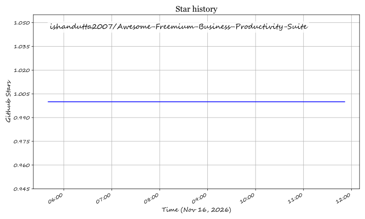

# Awesome Freemium Business Productivity Suite

  

  
  
  
  
  

> 💼 A curated list of top **Freemium Business Productivity Suites**, commercial SaaS office platforms, free-tier collaboration workspaces, self-hosted open-source software, and sovereign digital workplace tools. 🚀

---

## 🌟 Top Freemium Business Productivity Suite Ecosystem

**Curated List of SaaS Platforms & Open-Source GitHub Projects**  
*Focused on Free-Tier Office Suites, Self-Hosted Collaboration, and Digital Sovereignty*  
📅 **Last updated: March 2026**

This repository tracks notable **SaaS platforms** and **open-source projects** for **Freemium Business Productivity Suites**. These tools bundle word processing, spreadsheets, presentations, email, cloud storage, and team collaboration into integrated workspaces—covering everything from generous free tiers in commercial cloud suites to self-hosted open-source alternatives that eliminate per-user licensing entirely. 🌐

**🔑 Key Examples**: Microsoft 365, Google Workspace, Lark, Zoho Workplace, Notion, AppFlowy, AFFiNE, Nextcloud Hub, OnlyOffice, Collabora Online, CryptPad, and LibreOffice.

**🛡️ Open-source emphasis**: This guide highlights major active open-source repositories for self-hosted office suites, end-to-end encrypted collaboration tools, and community-driven productivity stacks—ideal for organizations seeking data privacy, European/global digital sovereignty, avoiding recurring per-seat SaaS costs, and retaining complete document ownership. The open-source landscape is genuinely mature: **Collabora Online** brings LibreOffice's engine to the browser 🖥️, **OnlyOffice** offers high Microsoft format fidelity with real-time co-authoring 📝, **Nextcloud Hub** provides an all-in-one sovereign collaboration platform ☁️, **AppFlowy** and **AFFiNE** offer modern open-source modular workspace canvases 🎨, and **CryptPad** delivers zero-knowledge encrypted productivity 🔒.

🤝 Contributions welcome! Open a PR to add or update entries. Please keep descriptions factual and link to official documentation.

---

## 📑 Table of Contents
- [📊 Sector Overview & Market Dynamics](#-sector-overview--market-dynamics)
- [🏢 SaaS/Hosted Platforms](#-saashosted-platforms)
- [💻 Open-Source GitHub Projects](#-open-source-github-projects)
- [💡 How to Contribute](#-how-to-contribute)
- [💖 Support](#-support)
- [⭐ Star History](#-star-history)
- [⚠️ Disclaimer](#-disclaimer)

---

## 📊 Sector Overview & Market Dynamics

The global business productivity software market is valued at approximately **$104B–$116B** (projected to exceed $150B by 2028 at an ~11–13% CAGR), driven by generative AI integrations, cloud migration, and hybrid enterprise workflows. 📈 The sector exhibits a **highly concentrated, winner-take-most structure** at the top layer dominated by the Microsoft 365 and Google Workspace duopoly, accompanied by a dynamic, fragmented tier of specialized modular workspaces (Notion, Lark) and digital-sovereignty-focused open-source ecosystems (Nextcloud, OnlyOffice, Collabora). ⚖️

---

## 🏢 SaaS/Hosted Platforms

| Product | Description | Pricing (Starting Tier) | Free Tier / Trial Limits | Valuation / Market Cap / Revenue |
|---|---|---|---|---|
| **[Microsoft 365](https://www.microsoft.com/en-us/microsoft-365/)** | Enterprise productivity benchmark including Word, Excel, PowerPoint, Outlook, OneDrive, and Teams. | **$6.00/user/month** (annual billing for Business Basic; or $7.00/user/month billed monthly) | **1-month free trial** (up to 25 users; credit card required; full Business Standard app access; no permanent free tier) | **~$3.87T Market Cap** (Enterprise leader) |
| **[Google Workspace](https://workspace.google.com/)** | Cloud-native collaboration suite featuring Gmail, Docs, Sheets, Slides, Drive, and Meet with Gemini AI capabilities. | **$6.00/user/month** (annual billing for Business Starter; or $7.20/user/month billed monthly) | **14-day free trial** (up to 10 users; custom business domain & 30 GB storage/user; no permanent free tier) | **~$3.64T Market Cap** (Alphabet Inc.) |
| **[Lark](https://www.larksuite.com/)** | All-in-one unified collaboration hub combining Docs, Sheets, multi-modal chat, video conferencing, and Base databases. | **$12.00/user/month** (annual billing for Pro plan; or $14.40/user/month billed monthly) | **Free plan permanently**: up to 20 users, 100 GB cloud storage, 1,000 automation runs/month, 60-min call limit | **~$480B+ Valuation** (ByteDance parent; >$180B revenue) |
| **[Zoho Workplace](https://www.zoho.com/workplace/)** | Integrated office and communications ecosystem offering Mail, WorkDrive, Writer, Sheet, Show, Cliq, and Meeting. | **$3.00/user/month** (annual billing for Workplace Standard; or $4.00/user/month billed monthly) | **Free Forever plan**: up to 5 users, 5 GB mail storage/user, web-only access (IMAP/POP disabled), 1 shared domain | **~$12.5B Valuation** (Bootstrapped; ~$1.5B annual revenue) |
| **[Notion](https://www.notion.so/)** | Connected workspace unifying docs, knowledge wikis, project databases, and workflow automations. | **$10.00/user/month** (annual billing for Plus plan; or $12.00/user/month billed monthly) | **Free plan permanently**: unlimited blocks for solo users; **1,000-block workspace ceiling** for 2+ team members, 5 MB file upload limit | **~$11B Valuation** (Private tender; ~$600M ARR) |

---

## 💻 Open-Source GitHub Projects

| Project | Stars_Badge | Description |
|---------|------------|-------------|
| **[AppFlowy](https://github.com/AppFlowy-IO/AppFlowy)** |  | **The leading privacy-first, open-source Notion alternative.** Built with Flutter and Rust, AppFlowy offers customizable notes, wikis, database boards, and project management with local-first encryption, community plugins, and self-hosted sync. 🦀 |
| **[AFFiNE](https://github.com/toeverything/AFFiNE)** |  | **All-in-one workspace uniting docs, whiteboards, and database tables.** Features a true dual-mode canvas where text documents transform instantly into infinite whiteboard canvases for collaborative planning and knowledge management. 🎨 |
| **[Nextcloud Hub](https://github.com/nextcloud/server)** |  | **The most complete sovereign enterprise collaboration platform.** Integrates Files, Groupware (Calendar/Contacts), Talk (chat & audio/video), and real-time document editing via Collabora Online or OnlyOffice on self-hosted infrastructure. ☁️ |
| **[Etherpad](https://github.com/ether/etherpad-lite)** |  | **Pioneering real-time collaborative text editor.** Highly lightweight and extensible with hundreds of plugins, Etherpad powers real-time simultaneous document drafting, author color tagging, and multi-user pad workflows across the web. 📝 |
| **[CryptPad](https://github.com/cryptpad/cryptpad)** |  | **End-to-end encrypted collaborative productivity suite.** Includes rich text, spreadsheets, code editors, presentations, Kanban boards, and polls where all document content is client-side encrypted before reaching the server. 🔐 |
| **[OnlyOffice Document Server](https://github.com/ONLYOFFICE/DocumentServer)** |  | **Leading Microsoft OOXML-compatible online office suite.** High-fidelity document rendering for DOCX, XLSX, and PPTX with real-time co-editing, track changes, and seamless integration into Nextcloud, ownCloud, and SharePoint. 📄 |
| **[LibreOffice Core](https://github.com/LibreOffice/core)** |  | **Flagship desktop open-source office suite.** Comprehensive offline suite powering Writer, Calc, Impress, Draw, Base, and Math with full OpenDocument Format (ODF) fidelity, serving as the upstream codebase for browser-based office engines. 🖥️ |
| **[Collabora Online](https://github.com/CollaboraOnline/online)** |  | **Enterprise-grade server-rendered LibreOffice in the browser.** Delivers uncompromising ODF rendering, real-time multi-user document collaboration, and sovereign document controls with minimal browser footprint. 🌐 |
| **[Apache OpenOffice](https://github.com/apache/openoffice)** |  | **Classic open-source desktop office suite.** Writer, Calc, and Impress with low hardware requirements, ideal for legacy computing environments and offline document processing. 📦 |

**🛠️ Frameworks for building custom systems**: Choose **Collabora Online** for ODF-faithful browser editing, **OnlyOffice** for Microsoft-format fidelity, or **Nextcloud Hub** for a complete sovereign collaboration platform with desktop and browser options—all without per-user subscription fees that compound across teams.

---

## 💡 How to Contribute

1. 🍴 Fork the repository.
2. ✍️ Add or edit entries in `README.md` (follow the existing format and tabular guidelines).
3. 📌 Include: product/project name, official link, 1–2 sentence description, and transparent pricing/free-tier specifics.
4. 🚀 Submit a PR with a short explanation.

⭐ **Star the repo** if you find it helpful!

---

## 💖 Support

Thank you for exploring and using this curated guide! Building and maintaining open resources for digital sovereignty, transparent freemium software limits, and open-source productivity requires continuous research and updates. 🙏

If you find this repository valuable, please consider supporting the project:
- ⭐ **Star this repository** to improve discoverability on GitHub!
- 🍴 **Fork it** and contribute your own discoveries or corrections.
- 📢 **Share it** with fellow developers, sysadmins, IT teams, and tech communities.
- ☕ **Buy me a coffee**: Support ongoing open-source curation and development via my [GitHub Sponsors Dashboard](https://github.com/sponsors/ishandutta2007)!

---

## ⭐ Star History

---

## ⚠️ Disclaimer

- ℹ️ This is a **community-curated** list — not exhaustive and not an endorsement.
- 🔒 Productivity suites handle business documents and potentially sensitive data; enforce access controls, encryption, and compliance with applicable data protection regulations.
- 🔍 **Freemium limits are not all equal.** **Notion's free tier is genuinely unlimited for solo users** but **caps multi-member workspaces at 1,000 blocks**—and deleting content does not reduce the block count, so teams hit the ceiling permanently. **Lark offers up to 20 users free** with 100 GB storage—one of the most generous team allowances. **Zoho's free plan is web-only** with no IMAP/POP access, limiting its usefulness for teams needing desktop email clients. **Google Workspace and Microsoft 365 offer only time-limited trials** (14 days and 1 month respectively), not permanent free tiers. **Open-source alternatives eliminate per-user fees but require operational effort**: Collabora Online is stateful and harder to scale, OnlyOffice requires integration work with Nextcloud or other platforms, and Nextcloud Hub needs PHP/database/Redis deployment. **Validate whether you need a free tier for a small team (Lark, Zoho), a trial before commitment (Google, Microsoft), or a self-hosted sovereign platform (Nextcloud, Collabora)** before committing.

---

**Made with ❤️ for IT administrators, operations teams, and organizations building productivity infrastructure.**  
Let's make business productivity suites more open, sovereign, and cost-predictable. 🚀

## ⭐ Star History

<a href="https://star-history.com/#ishandutta2007/Awesome-Freemium-Business-Productivity-Suite&Timeline" align="center">
  <picture>
    <source media="(prefers-color-scheme: dark)" srcset="assets/ishandutta2007_Awesome-Freemium-Business-Productivity-Suite_growth.svg">
    
  </picture>
</a>
